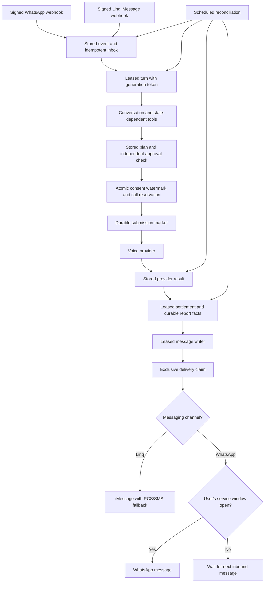

# The Desk: bounded personal assistance

The Desk handles phone errands. Personal context reduces repetition; it never grants permission to act. It remembers explicit preferences and clear enduring corrections, recalls this user's past places and errands, and follows through on accepted work. It does not add a companion mode, new agents, or broader advice capabilities.

Every call still rests on an approved calling plan. The request version, consent, latest inbound message watermark, stop state, caller contract, timing, and limits are enforced in PostgreSQL. A remembered preference is evidence for preparing the plan, not an approval.

## Processing and recovery



- Storing an event does not mean ingestion completed. `ingested_at` is set only after its messages are persisted; reconciliation replays unfinished stored events.
- Claiming a turn assigns an input batch and generation token. `handled_at` is set at successful completion. Failed or expired claims can resume; heartbeats renew live work. A stale generation cannot mutate requests, calls, consents, or memories through a fenced client.
- Approval captures the exact inbox watermark evaluated. Ingestion, consent recording, and reservation use the same user lock. Newer inbound invalidates the action before reservation.
- An approval committed before a worker crash remains recoverable. A non-retry consent can reserve only one call. An intentional retry remains governed by its existing consent, retry limits, and timing rules.
- Before contacting the provider, the call is marked as a potentially submitted action. A transport failure or a failed attempt-ID write remains uncertain, never “nothing happened.” There is no automatic resubmission of an uncertain call. Calls known not to have reached submission can be settled as not submitted.
- Provider completion and application settlement are separate. A terminal provider result remains recoverable until settlement and owed report facts commit together. Settlement claims prevent competing workers; delayed real results after a reported timeout create an explicit user update and operator incident.
- Send claims use row locks and ownership tokens. Writer claims have their own tokens. A stale worker cannot acknowledge a successor's work. External services do not provide a distributed transaction with our database, so simultaneous claim prevention does not establish exactly-once external delivery after an ambiguous send response.
- Unintended commitments are stored in the user's report facts and an operator alert. They do not automatically authorize a corrective call.

## WhatsApp messaging

The latest **user** message opens a 24-hour service window. Outgoing messages do not extend it.

- The shared delivery path rejects paid templates.
- A closed window leaves updates pending, without consuming their retry budget. Inbound ingestion wakes deferred updates.
- Unfinished work may produce one useful update shortly before expiry. The minute tick considers the last two minutes, leaving time for writing and delivery. This is best effort, not a promise of delivery in an exact second.
- No unfinished work means no window update. A new user message invalidates an unsent closing-window update. There are no repeated keep-alives or automatic paid reopen messages.
- Do not promise a reminder outside the current service window. Keep the waiting commitment and explain that the user can message again to continue.
- Provider analytics reconciliation stays on its existing five-minute schedule. The separate one-minute `follow-through` function handles due messages and local erasure without polling voice analytics each minute.

## Personal context

`user_memories` remains a small, capped relational store. Production writes reference a stored user message. Learned corrections must quote it; a correction can atomically replace an existing memory. Forgetting removes the row. The `recall_errands` tool returns at most five user-scoped records with the place, request details, state, and recorded outcome. It is not a general conversation search or a vector database.

An explicit data-deletion request stops further calls and immediately removes memory. The erasure worker waits while real-world calls or unsettled results remain outstanding, then deletes the local profile and related records, including raw provider events and detached user failure records. It retains only an anonymous completion audit. A completion message uses the original channel; WhatsApp requires its existing service window to remain open and is not logged back into a recreated profile. This does not cancel a booking or erase a business's or platform provider's independently held records.

## Operations

`linq-inbound`, `wa-inbound`, and `sarvam-webhook` are public provider entrypoints; they validate their respective signature/token. `health`, `reconcile`, and `follow-through` require an exact authorized machine credential in addition to gateway validation. The legacy `dial` and `wa-send` HTTP endpoints require the same authorization and return 410 without taking action. Dialing remains an internal module.

Health includes stale inbox work, unsettled results, unresolved submissions, failed deliveries, pending erasure, and overdue owed messages. Missing health credentials fail CI monitoring. Model measurements record model/tool names, token counts, and latency, not prompts, screenshots, or generated text. `record_call_cost(call_id, actual_rupees)` records a real reported charge idempotently and adjusts the ledger by the difference. No provider price or balance is invented; operators must supply actual costs until a supported billing integration is configured.

CI pins Deno 2.9.6 and Supabase CLI 3.0.0. Most test assertions use the runtime's native Node assertions; the Linq tests also use the locked JSR standard assertions. Search fallback requires branch-address evidence as well as a matching name before attaching a web phone number.

## Validation

From the checkout, with Deno and Supabase CLI on `PATH`:

```sh
deno task check
deno task test
deno task test:auth
deno task test:bench
supabase db start
supabase test db
python3 scripts/test_db_concurrency.py
```

The authorization script launches actual local endpoint entrypoints using a fake local test credential. The concurrency script uses independent PostgreSQL sessions through the local Docker socket and cleans up only its own UUID-scoped fixtures. Never run it against a production database.

Live model, WhatsApp, and voice qualification still require the documented credentials and consenting test numbers. Mocked tests and local migrations do not establish that a remotely configured voice caller is correct.

## Deployment

These changes are source and local database changes; they do not deploy or retire hosted functions automatically.

1. Replace old hosted `dial` and `wa-send` functions with this release's authenticated 410 retirement handlers. Removing source alone would leave old hosted implementations active.
2. Use the existing kill switch and drain running old workers during the migration/deployment interval. On `imessage-linq`, preserve deployed 0016–0018 and apply 0019–0022. Deploy the channel adapters and shared workers together, including `follow-through` and the retirement handlers. Calling stays paused until the owner explicitly resumes; authorization, scheduled-job health, and caller qualification must be checked first.
3. The existing `desk_project_url` and `desk_service_key` Vault bindings must match the deployed project and current platform-injected service key. A legacy service-role JWT and a newer Supabase secret key are different credentials; align the GitHub daily monitor with the same key too. No worker runs successfully until those are configured.
4. Qualify a complete round trip on consenting test numbers before lifting the kill switch for real businesses. Include correction, interruption, provider uncertainty, and result recovery.
5. Review historical stranded work. Recovery can replay retained events and results; it cannot reconstruct events that have already been purged or prove what an unobserved old external action did.

The live caller instructions/configuration are an external release prerequisite. See [agent/README.md](agent/README.md); the code must not invent an instructions hash or claim that a database pin proves the provider is running the same configuration.

## iMessage branch

The same hosted Supabase project stores separate user identities for Linq and
WhatsApp. The shared runtime and scheduled recovery dispatch by persisted channel.
WhatsApp's 24-hour policy does not apply to Linq. See [README.imessage.md](README.imessage.md)
for the release record, native contact-card handling, and the hardcoded owner-only,
paused calling configuration.
